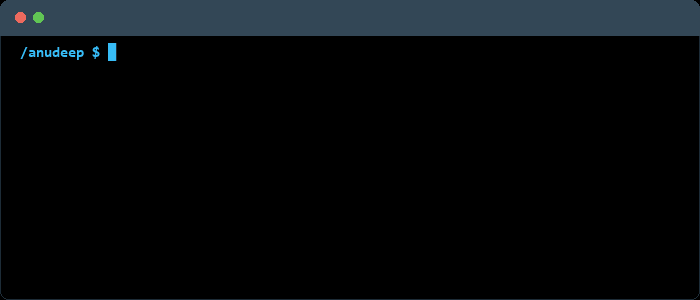

 

    

---

<table width="100%">
  <tr>
    <th width="50%" align="center"><h3>🛠️ Main Skills (Enterprise &amp; Platform)</h3></th>
    <th width="50%" align="center"><h3>💻 Projects Tech Stack</h3></th>
  </tr>
  <tr>
    <td align="center" valign="top">
       
      
        
      
      
      
       
      
      
      
       
      
      
        
    </td>
    <td align="center" valign="top">
       
      
        
      
      
        
    </td>
  </tr>
</table>

### 🔭 Studying & Advanced Practice

---

### 🏆 Industry Certifications & Credentials

| Domain | Credential & Specialization | Verified Badge |
| :--- | :--- | :--- |
| **Microsoft** | Windows Server Hybrid Administrator Associate (`AZ-800`, `AZ-801`) |  |
| **Amazon Web Services** | AWS Certified Solutions Architect – Associate (`SAA-C03`) |  |
| **Amazon Web Services** | AWS Certified CloudOps Engineer – Associate |  |
| **Nutanix** | Nutanix Certified Professional – Multicloud Infrastructure (`NCP-MCI 6`) |  |
| **Nutanix** | Nutanix Certified Associate (`NCA 6`) |  |
| **IBM** | Generative & Agentic AI Consultant / Business Analyst |  |
| **IBM** | Generative & Agentic AI Foundation |  |
| **Anthropic** | Claude Certified Developer – Foundations |  |
| **Anthropic** | Claude 101: AI-Assisted Workflows & System Documentation |  |

---

### Featured Projects
- ⚡ **[PulseGuard](https://github.com/Anudeep-Adari/PulseGuard)** &mdash; High-performance Windows diagnostic telemetry, MMCSS latency tuning, and predictive NVMe wear forecaster.
- 🛡️ **Monitoring Sentinel** &mdash; Autonomous hybrid infrastructure sentry combining kernel telemetry with agentic AI root cause analysis *(In Active Dev)*.
- 🌐 **[JobNexus](https://github.com/Anudeep-Adari/JobNexus)** &mdash; Local Model Context Protocol (`MCP`) server for Claude Desktop and Cursor AI with in-memory DPDPA compliance.
- 🧹 **[DigitalHygieneAuto](https://github.com/Anudeep-Adari/DigitalHygieneAuto)** &mdash; Event-driven background file sentry with journaled, reversible classification and automated storage cleanup.
- 🩺 **[SysHealth-Pro](https://github.com/Anudeep-Adari/SysHealth-Pro)** &mdash; Modular hardware telemetry and collector architecture with minimal (<1%) CPU overhead.

---

### Connect with me!

 
  
  
  

---

### Status & Activity `(͠≖ ͜ʖ͠≖)👌`

  

  

  

