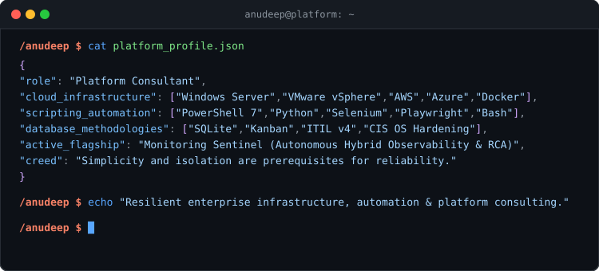

 

    

---

### Main skills

  
  
  
  
  

### Studying

---

### Featured Projects
- ⚡ **[PulseGuard](https://github.com/Anudeep-Adari/PulseGuard)** &mdash; High-performance Windows diagnostic telemetry, MMCSS latency tuning, and predictive NVMe wear forecaster.
- 🛡️ **Monitoring Sentinel** &mdash; Autonomous hybrid infrastructure sentry combining kernel telemetry with agentic AI root cause analysis *(In Active Dev)*.
- 🌐 **[JobNexus](https://github.com/Anudeep-Adari/JobNexus)** &mdash; Local Model Context Protocol (`MCP`) server for Claude Desktop and Cursor AI with in-memory DPDPA compliance.
- 🧹 **[DigitalHygieneAuto](https://github.com/Anudeep-Adari/DigitalHygieneAuto)** &mdash; Event-driven background file sentry with journaled, reversible classification and automated storage cleanup.
- 🩺 **[SysHealth-Pro](https://github.com/Anudeep-Adari/SysHealth-Pro)** &mdash; Modular hardware telemetry and collector architecture with minimal (<1%) CPU overhead.

---

### Connect with me!

 
  
  
  

---

### Status & Activity `(͠≖ ͜ʖ͠≖)👌`

  

  

  

